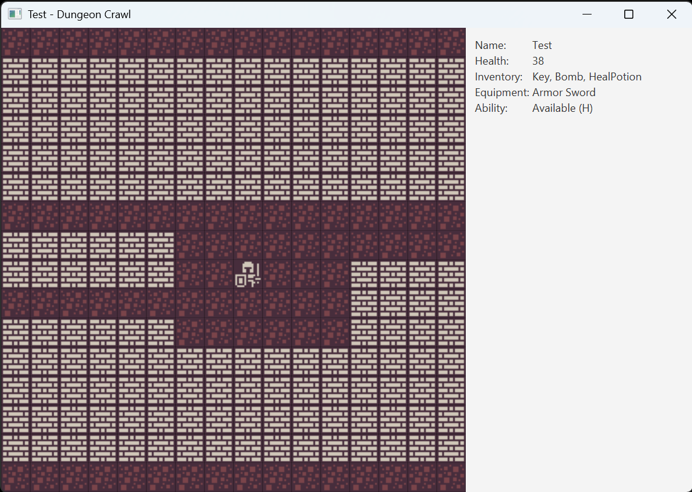
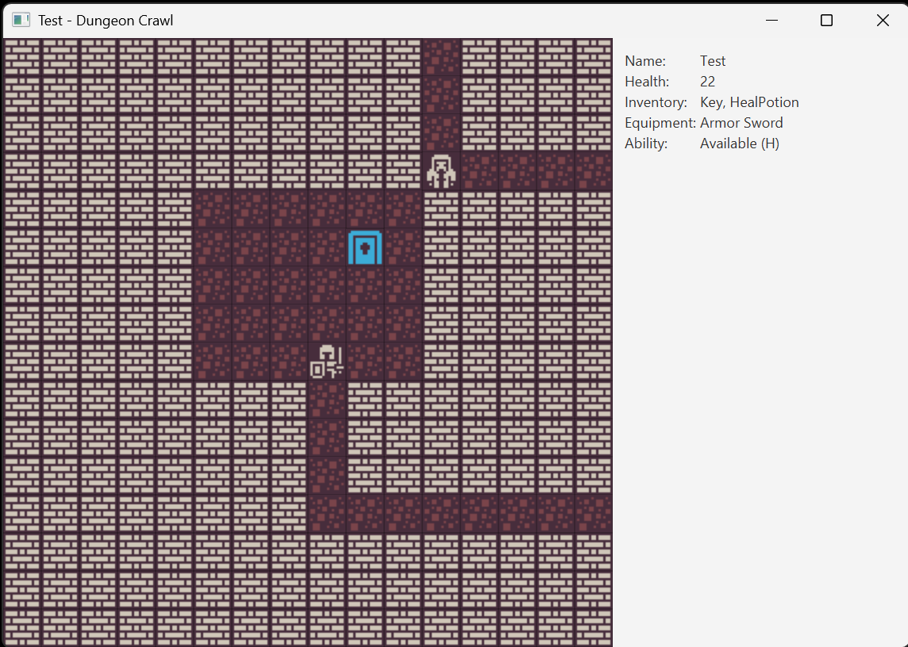
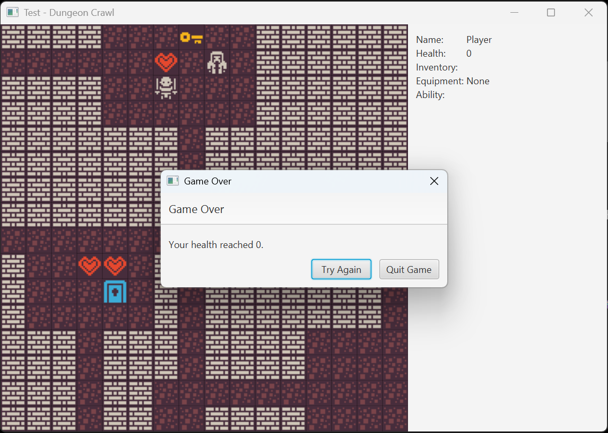

# Dungeon Crawl

**A JavaFX dungeon crawler with procedural maps, turn-based combat and equipment.**

Dungeon Crawl is a desktop game originally developed during a two-week team project at Codecool. Explore randomly generated rooms and corridors, fight monsters, collect useful items, and find the key to unlock the exit to the next level.

## Features

- **Procedural dungeon generation:** randomized rooms, connected corridors, enemy spawns and loot.
- **Three enemy types:** Fighter, Assassin and Mage, each with different combat or movement behavior.
- **Combat and equipment:** health, attack range, armor, swords and monster encounters.
- **Items:** keys, healing potions and bombs; equipment and consumables affect gameplay.
- **Level progression:** collect a key and reach the exit door to enter a new dungeon.
- **JavaFX interface:** tile-based map, player status, equipment and inventory display.

## Screenshots

| Exploration and equipment | Finding the dungeon exit |
| --- | --- |
|  |  |

**Game Over and retry**



## Controls

| Key | Action |
| --- | --- |
| Arrow keys | Move and attack adjacent enemies |
| `H` | Use a healing potion |
| `B` | Use a bomb |

## Tech stack

| Area | Technologies |
| --- | --- |
| Application | Java 17, JavaFX 17, Maven |
| Persistence | PostgreSQL, JDBC, dotenv-java |
| Testing | JUnit 5, JaCoCo |
| Local environment | Docker, Docker Compose, Maven Wrapper |

## Run locally (no IDE required)

**Prerequisites:** Java JDK 17, Docker Desktop (or Docker Engine with Compose), and a Bash-compatible terminal (such as Git Bash on Windows). No separate Maven installation is required.

1. Clone the repository:

   ```bash
   git clone https://github.com/Atis18/dungeon-crawl-java-some-good-game-1802.git
   cd dungeon-crawl-java-some-good-game-1802
   ```

2. Create a local configuration file:

   ```bash
   cp .env.example .env
   ```

   Set a non-empty `DB_PASSWORD` in `.env`. The file also defines `DB_URL` and `DB_USER`. **Do not commit `.env` or real credentials.**

3. Start Docker Desktop, then launch the game:

   ```bash
   bash scripts/run.sh
   ```

   The script starts PostgreSQL via Docker Compose, waits for it to become ready and launches JavaFX through the Maven Wrapper. The first launch may download Maven and Java dependencies.

4. When finished, stop the database container:

   ```bash
   docker compose -f compose.db.yaml down
   ```

   The named PostgreSQL volume is preserved, so database data remains available on the next start.

### Manual launch

If you prefer to run the steps separately:

```bash
docker compose -f compose.db.yaml up -d
bash ./mvnw -B -ntp javafx:run
```

> **Note:** PostgreSQL is initialized when the application starts. Save/load support exists in the codebase, but save/load tiles are not currently placed in normally generated levels. It is not presented as a finished gameplay feature.

## Testing and code coverage

Run the automated unit tests and generate the JaCoCo report:

```bash
bash ./mvnw -B -ntp clean verify
```

The current portfolio version has **67 automated JUnit tests**, covering combat, inventory, items, map loading, procedural map generation and game logic.

Open the generated coverage report in your browser:

```text
target/site/jacoco/index.html
```

### Reproducible Docker build

Build and test the application inside a container:

```bash
docker build -t dungeon-crawl-tests .
```

The Dockerfile is intended for a **reproducible Maven build and test run**. It does **not** display the JavaFX desktop window; use the local launch instructions above to play the game.

## Project structure

```text
src/main/java/com/codecool/dungeoncrawl/
  data/                 Game state, actors, items, cells, database
  logic/                Game rules, combat, map generation
  ui/                   JavaFX rendering and keyboard input
src/test/java/          JUnit tests
scripts/run.sh          Local database startup and JavaFX launcher
compose.db.yaml         PostgreSQL for local development
Dockerfile              Containerized build and unit tests
```

## My contributions to the original team project

During this two-week team project, I was **primarily responsible for the map and level-generation system** and also took on an informal coordination role:

- **Maps and procedural generation (main development contribution):** implemented the vast majority of the map and level-generation functionality, including generating dungeon rooms and connecting them with corridors. Other teammates also contributed to the overall game.
- **Task coordination:** helped divide responsibilities among teammates, including monsters, inventory and items, movement and persistence, and special abilities.
- **Team communication:** organized progress discussions to review completed work, resolve blockers, and plan the next steps.
- **Git integration:** handled branch merges and integrated teammates' work into the shared codebase.

The game was developed collaboratively. The [original repository history](https://github.com/CodecoolGlobal/dungeon-crawl-java-some-good-game-1802) provides further context about the team's work.

## Team project and attribution

This game originated as a **two-week Codecool team project**. This repository is a personal fork used to prepare the project for a development portfolio.

Portfolio improvements in this fork include additional automated tests, targeted gameplay fixes, deterministic map-generation testing, JaCoCo coverage reporting, Docker-based build verification, a Maven Wrapper and a documented local startup process.

Original team repository: [CodecoolGlobal/dungeon-crawl-java-some-good-game-1802](https://github.com/CodecoolGlobal/dungeon-crawl-java-some-good-game-1802).
